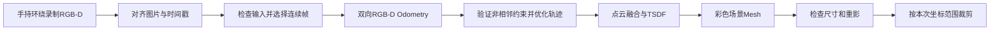

# D435i Handheld Reconstruction

**手持Intel RealSense D435i围绕静止物体拍摄，将RGB-D序列重建为彩色点云和三维Mesh。**

项目提供从录制、数据提取、输入检查、相机轨迹估计，到Pose Graph优化、TSDF融合及模型检查的完整离线工作流，适用于家具等物体的实验性建模。

> **存在重建误差。** 手持扫描可能出现累计漂移、拉伸、重影、碎片和缺面。运行完成或配准通过检查不等于模型准确。目前没有独立的实测精度标定，不能给出固定毫米误差或准确率，不适用于制造、计量或精密装配。

## 完整工作流



`run_handheld_reconstruction.py`统一编排轨迹估计、优化和重建，`run_pipeline.py`负责融合、模型处理及输出校验。所有结果使用独立目录，原始数据保持不变。

## 安装

验证环境为Windows 11、Python 3.14、Open3D 0.20.0。具体版本见[requirements.txt](requirements.txt)。相机录制和DB3回放还需要兼容的RealSense SDK与pyrealsense2。

```powershell
git clone https://github.com/lilili-maker/d435i-handheld-reconstruction.git
cd d435i-handheld-reconstruction
python -m venv .venv
.\.venv\Scripts\python.exe -m pip install -r requirements.txt
$env:PYTHONUTF8 = "1"
$env:PYTHONIOENCODING = "utf-8"
```

已有可用虚拟环境时，可以直接调用其中的Python。CPU即可完成重建；GPU是否可用取决于当前Open3D构建和运行环境，不能仅根据显卡型号判断。

## 快速体验：不连接相机

仓库提供已知三面角的合成RGB-D生成器，用于验证完整软件流程。它不是家具扫描数据，也不能证明真实测量精度。

```powershell
$demoId = Get-Date -Format 'yyyyMMdd_HHmmss'
$demoInputs = "output/demo_inputs_$demoId"
$demoOutput = "output/demo_reconstruction_$demoId"

.\.venv\Scripts\python.exe scripts/create_synthetic_demo.py --output $demoInputs
.\.venv\Scripts\python.exe run_handheld_reconstruction.py `
  --dataset "$demoInputs/synthetic_dataset" `
  --start 0 --end 2 --step 1 --reference 0 `
  --odometry-backend legacy --device CPU:0 --min-consistency 0.6 `
  --min-loop-gap 50 --max-loop-candidates 0 --no-crop --output $demoOutput
```

该命令从图像实际计算Odometry并融合三帧。已知真值单独保存在`poses/camera.json`，标记为simulation，不作为估计结果输入。运行后按`handheld_report.json`中的路径打开场景Mesh。

## 从拍摄到三维模型

保持家具及背景静止，关闭RealSense Viewer等占用相机的程序。手持相机缓慢环绕，保留相邻视角重叠，并覆盖目标的不同高度。旋转椅应固定座面与底座，避免各部分相对运动。详见[拍摄指南](docs/SCANNING_GUIDE.md)。

以下命令使用同一组变量贯穿录制、提取和检查：

```powershell
$scanId = Get-Date -Format 'yyyyMMdd_HHmmss'
$recording = "data/raw/scan_$scanId.db3"
$dataset = "data/extracted_$scanId"
$analysis = "output/analysis_$scanId"
$result = "output/handheld/scan_$scanId"

# 录制窗口按q停止，等待文件正常关闭。
.\.venv\Scripts\python.exe src/02_record_data.py --output $recording
.\.venv\Scripts\python.exe src/03_extract_rgbd.py --input $recording --output $dataset
.\.venv\Scripts\python.exe src/reconstruction/analyze_handheld_dataset.py `
  --dataset $dataset --output $analysis
```

查看`dataset_analysis.json`的配对数量、问题帧、时间戳和候选连续区间，并查看`rgb_overview.png`。选择本次数据中实际存在、深度有效、RGB清楚的短连续区间。

例如，确认10～60帧符合条件后运行：

```powershell
.\.venv\Scripts\python.exe run_handheld_reconstruction.py `
  --dataset $dataset --start 10 --end 60 --step 1 --reference 10 `
  --odometry-backend legacy --device CPU:0 --cpu-threads 4 `
  --min-consistency 0.6 --min-loop-gap 50 --max-loop-candidates 10 `
  --fusion-step 1 --no-crop --output $result
```

10～60是命令示例，不是适用于每次扫描的固定范围。参考帧必须属于采样列表，建议使用RGB清楚、有效深度充足的帧。`--no-crop`用于尚未确认裁剪范围的输入，生成的是场景Mesh。

先检查短序列的形状和尺寸，再扩大到本次数据中已检查的连续区间。输入质量通过只代表图片、时间和深度满足基本条件，不能证明整段轨迹可靠。

录制优先使用640×480、30 FPS的Color/Depth，并按设备支持情况尝试记录IMU。本流程使用RGB-D估计运动，没有进行视觉惯性融合。

## 已有数据与输入格式

已有提取的RGB-D时，可以直接从输入检查和重建命令开始，显式填写`--dataset`、帧范围、参考帧、`--no-crop`及输出目录。

```text
data/extracted_scan/
  color/000000.png ...
  depth/000000.png ...       # 原始二维uint16
  camera_intrinsics.json
  timestamps.csv
```

| 输入 | 要求 |
| --- | --- |
| RGB与Depth | 同编号一一对应；Depth已对齐Color，尺寸与内参匹配 |
| 相机参数 | `width,height,fx,fy,cx,cy,depth_scale` |
| 参数声明 | `intrinsics_unit=pixels`、`depth_scale_unit=meters_per_depth_unit`、`depth_dtype=uint16`、`depth_aligned_to=color` |
| 时间戳CSV | `frame_id,color_timestamp_ms,depth_timestamp_ms` |

Depth使用原始uint16，不保存伪彩色或归一化深度。SDK比例为米/原始深度单位，Open3D的深度除数取倒数，例如0.001对应1000。程序读取实际文件转换，不按示例值覆盖。

DB3必须是兼容SDK录制的RealSense数据。普通SQLite文件改扩展名不能作为输入。仓库不附真实录制、RGB-D长序列或实验室模型；请使用自己的数据。

## 参数与计算开销

| 参数 | 含义 |
| --- | --- |
| `--start/--end/--step` | 闭区间采样；step须为正且整除end-start |
| `--reference` | 临时世界坐标系；分别向前、向后跟踪，当前不自动选择最优参考帧 |
| `--odometry-backend legacy/tensor` | 官方Open3D两种RGB-D后端，默认tensor |
| `--device auto/CPU:0/CUDA:0` | 自动选择或显式要求设备；Legacy Odometry使用CPU |
| `--cpu-threads` | CPU线程数，默认4 |
| `--min-consistency` | 双向深度重投影支持门槛，默认0.4；本文示例显式使用0.6 |
| `--max-translation/--max-rotation` | 每次注册的运动筛查，默认0.15米/15度 |
| `--fusion-step` | 每N个有效跟踪帧融合一次，默认1；不改变Odometry采样 |
| `--skip-pointcloud` | 省略独立点云合并，仍生成彩色Mesh |
| `--max-loop-candidates` | 非相邻约束候选检查上限；0关闭候选检查 |
| `--max-skip-frames` | 默认0，失败即停该方向；允许跳帧时仍必须重新配准通过检查 |
| `--max-recovery-gap-ms` | 跳帧候选距最后可靠帧的时间差上限，默认200毫秒 |
| `--icp-refinement` | 默认off；geometry仅用于显式诊断 |

资源有限时，可以在已验证区间使用`--fusion-step 3 --skip-pointcloud`减少融合负担。Tensor可能更快，但不保证更准，建议先在相同短区间比较后端。

`--device auto`仅在Open3D实际支持CUDA时使用GPU，否则记录CPU回退；显式要求不可用的CUDA设备会报错。**0.4门槛不是40%准确率**，降低门槛可能接纳更差的配准，提高通过帧数不能作为唯一目标。

当前手持入口生成的融合配置使用深度范围0.2～3米、TSDF体素0.01米和截断距离0.04米。需要调整时，应检查生成的配置及`run_pipeline.py`接口；这些数值不是设备精度保证。

## 输出与模型检查

```text
output/handheld/<本次运行>/
  handheld.log
  handheld_report.json
  tracking/
    poses_before.json
    registration_quality.json
  pose_graph/
    poses_optimized_proposal.json
    poses_for_reconstruction.json
    pose_graph_report.json
    trajectory_comparison.png
  models/run_0001/
    mesh/scene_mesh.ply
    pointcloud/merged.ply       # 未使用skip-pointcloud时
    reports/...
    pipeline_report.json
  pipeline_config.json
  model_quality_report.json
```

实际路径以报告为准。`status=complete`表示有效连通子段完成处理；同时检查`tracking_complete`、`tracking.valid_frame_count`、`actual_reconstruction_frame_count`、`fusion_frame_ids`及失败记录，区分请求帧数与实际融合帧数。

在CloudCompare或Open3D中打开实际`scene_mesh.ply`，观察双层表面、断裂、悬浮碎片和整体比例，并用实物测量检查尺寸。不要通过缩放、平滑或补洞掩盖位姿问题。

需要裁剪家具时，先在本次世界坐标系中确认AABB，再使用`src/reconstruction/clean_mesh.py --help`查看参数。不要复用另一次扫描的裁剪框。统一手持入口启用裁剪时还会比较指定的基线模型；没有相应基线时，可先生成场景Mesh，再单独裁剪。

## 失败处理与误差边界

失跟踪时读取`tracking/registration_quality.json`的source、target和failure_reasons。默认停止失败方向，未估计帧不参与融合，不使用单位矩阵或上一帧位姿补齐。可以把后续连续片段写入新目录独立重建，但没有可靠相对变换时不能直接叠加。

```text
T_world_camera：Camera-to-World，平移单位米
P_world = T_world_camera @ P_camera
P_target = T_source_to_target @ P_source
C_target = C_source @ inverse(T_source_to_target)
TSDF extrinsic = inverse(T_world_camera)
```

真实手持轨迹标记为`rgbd_odometry`。没有可靠非相邻约束时，链式Pose Graph不能消除累计漂移；优化成功也不证明真实位姿准确。金属、黑色材料、细杆、遮挡和物体运动都会影响结果。详见[误差与限制](docs/LIMITATIONS.md)。

## 测试与文档

```powershell
.\.venv\Scripts\python.exe -m unittest discover -s tests -v
```

当前包含130项离线测试，覆盖变换方向、双后端、Pose Graph、已知几何的TSDF融合、失败停止、受限恢复、RGB颜色、模型有效性及防覆盖。[GitHub Actions](https://github.com/lilili-maker/d435i-handheld-reconstruction/actions)在Windows环境执行测试和合成数据的完整重建。

- [拍摄指南](docs/SCANNING_GUIDE.md)
- [误差与限制](docs/LIMITATIONS.md)
- [验证范围与合成结果](docs/VALIDATION.md)
- [参与开发](CONTRIBUTING.md)

照片或点云转人工描边SVG，可参见[3DSVG Studio](https://github.com/lilili-maker/3dsvg-studio)。

## 许可

当前未附开源许可证。代码与数据的复制、修改及再分发范围以仓库所有者的授权为准。
