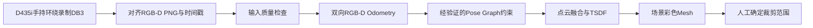

# D435i Handheld Reconstruction

**手持 Intel RealSense D435i，围绕静止家具拍摄 RGB-D，离线估计相机轨迹并生成彩色三维 Mesh。**

> **实验性项目，存在重建误差。** 实际扫描可能出现轨迹漂移、表面错位、拉伸、重影、悬浮碎片和孔洞。代码完成运行、配准通过检查或 Mesh 能打开，都不能证明模型尺寸和形状准确。目前没有独立的真实轨迹或尺寸标定，不能给出固定毫米误差或准确率；不适用于制造、计量或精密装配。

本仓库整理自原家具扫描项目的手持环绕拍摄流程。保留已实现的算法与保护检查，独立于照片描边工具 **3DSVG Studio**。不接入机器人，不控制运动，不人工补造未扫描的家具结构。

## 流程



主要入口是 `run_handheld_reconstruction.py`。它复用 `run_pipeline.py` 和 `src/reconstruction/`，没有第二套TSDF算法。附带的Mesh平面切片模块是原Pipeline依赖和可选工具，不是3DSVG Studio的照片描边工作流。

## 环境与安装

原本地验证环境：Windows 11、Python 3.14.4、Open3D 0.20.0，其他依赖锁定在 `requirements.txt`。新机器需安装依赖；已有可用 `.venv` 可以继续使用。

```powershell
git clone https://github.com/lilili-maker/d435i-handheld-reconstruction.git
cd d435i-handheld-reconstruction
python -m venv .venv
.\.venv\Scripts\python.exe -m pip install -r requirements.txt
$env:PYTHONUTF8 = "1"
$env:PYTHONIOENCODING = "utf-8"
```

CPU即可运行。`--device auto`会检查当前Open3D构建是否支持CUDA；存在NVIDIA显卡不等于Open3D已支持GPU。Legacy Odometry使用CPU；Tensor Odometry及TSDF能否使用GPU，以报告中的实际设备为准。显式要求不可用的CUDA设备会报错。不要为此盲目安装同名GPU包或替换环境。

## 1. 拍摄与提取

保持家具及背景静止，手持相机缓慢环绕。**不要一边移动相机，一边旋转椅子的上半部。** 先关闭RealSense Viewer，使用稳定光照，尽量完整拍到椅背、坐垫、扶手、支撑与底座。

```powershell
$scanId = Get-Date -Format 'yyyyMMdd_HHmmss'
$recording = "data/raw/scan_$scanId.db3"
$dataset = "data/extracted_$scanId"

.\.venv\Scripts\python.exe src/02_record_data.py --output $recording
# 预览窗口按q停止录制并关闭文件，再进行提取：
.\.venv\Scripts\python.exe src/03_extract_rgbd.py --input $recording --output $dataset
```

录制优先使用640×480、30 FPS的Color/Depth，并按设备实际IMU profile尝试录制运动数据。本流程的位姿估计使用RGB-D，**没有用IMU完成视觉惯性融合**。DB3录制/回放依赖兼容的RealSense SDK与pyrealsense2，不能把普通SQLite文件改扩展名当作录制。

更多拍摄建议见[拍摄指南](docs/SCANNING_GUIDE.md)。所有输出使用新目录，不覆盖旧扫描。

## 2. 检查输入，再选短区间

```powershell
$analysis = "output/analysis_$scanId"
.\.venv\Scripts\python.exe src/reconstruction/analyze_handheld_dataset.py --dataset $dataset --output $analysis
```

检查 `dataset_analysis.json` 的配对数量、问题帧、时间戳和候选连续区间，并查看 `rgb_overview.png`。输入检查通过只代表图片/时间/深度满足基本条件，**不代表相机轨迹可靠**。

所需数据结构：

```text
data/extracted_.../
  color/000000.png ...
  depth/000000.png ...       # 原始二维uint16
  camera_intrinsics.json
  timestamps.csv
```

内参必须明确 `width,height,fx,fy,cx,cy,depth_scale`，以及 `intrinsics_unit=pixels`、`depth_scale_unit=meters_per_depth_unit`、`depth_dtype=uint16`、`depth_aligned_to=color`。内参、RGB和Depth尺寸必须相同；字段声明不能代替对实际对齐质量的观察。

时间戳CSV字段为 `frame_id,color_timestamp_ms,depth_timestamp_ms`。例如SDK深度比例为0.001米/单位时，Open3D的深度除数为1000；程序读取实际文件并转换，禁止把0.001直接作为Open3D深度除数。

## 3. 先运行短序列

以下10～60仅示范命令格式，必须替换为本次数据中实际存在、输入合格的连续帧。参考帧需要属于采样列表，并且图像清楚、深度有效。

```powershell
$runId = Get-Date -Format 'yyyyMMdd_HHmmss'
.\.venv\Scripts\python.exe run_handheld_reconstruction.py `
  --dataset $dataset --start 10 --end 60 --step 1 --reference 10 `
  --odometry-backend legacy --device CPU:0 --cpu-threads 4 `
  --min-consistency 0.6 --min-loop-gap 50 --max-loop-candidates 10 `
  --fusion-step 1 --no-crop --output "output/handheld/short_$runId"
```

建议先用Legacy CPU作为短序列基线，再在相同数据上比较Tensor。`--no-crop`是新项目的重要参数：没有已经确认的裁剪框时，程序只生成场景Mesh，不猜测家具位置。直接使用脚本旧默认值会寻找本仓库未附带的历史数据及裁剪框。

## 4. 验证通过后再扩大，或减少融合负担

下面仍是假设10～210真实存在且已检查的示例，成功跟踪数可能小于请求数。

```powershell
$runId = Get-Date -Format 'yyyyMMdd_HHmmss'
.\.venv\Scripts\python.exe run_handheld_reconstruction.py `
  --dataset $dataset --start 10 --end 210 --step 1 --reference 10 `
  --odometry-backend tensor --device auto --cpu-threads 4 `
  --min-consistency 0.6 --min-loop-gap 50 --max-loop-candidates 10 `
  --fusion-step 3 --skip-pointcloud --no-crop `
  --output "output/handheld/extended_$runId"
```

`--fusion-step 3`只减少**已经通过检查的帧**参与融合的数量，Odometry仍按step逐帧计算。`--skip-pointcloud`只省略独立融合点云，仍重建彩色Mesh。它们不能修复错误位姿。Tensor可能更快，但不保证更准确，必须先进行同区间对比。

| 参数 | 实际含义 |
| --- | --- |
| `--start/--end/--step` | 闭区间采样；step须为正且整除end-start |
| `--reference` | 临时世界坐标系；从参考帧向前、向后分别跟踪，并非自动选择最优参考帧 |
| `--min-consistency` | 双向深度重投影支持门槛，范围(0,1]；旧默认0.4，本文示例显式使用0.6 |
| `--max-translation/--max-rotation` | 每次注册的运动筛查，默认0.15米/15度；不是误差保证 |
| `--max-skip-frames` | 默认0，失败即停该方向；显式允许跳帧时仍必须重配准通过原检查 |
| `--max-recovery-gap-ms` | 默认200毫秒，只限制跳帧恢复候选与最后可靠帧的时间差 |
| `--icp-refinement` | 默认off，防止几何ICP覆盖Hybrid的失败；geometry仅用于显式诊断 |
| `--max-loop-candidates` | 非相邻候选检查数量上限；0表示不尝试回环约束 |

**0.4门槛不等于40%准确率。** 降低门槛可能接受不可靠结果；更高通过率也不说明模型更准。项目未改动旧算法默认值，以保证复现。

## 5. 输出、失败和结果检查

```text
output/handheld/<本次运行>/
  handheld.log
  handheld_report.json
  tracking/
    poses_before.json
    registration_quality.json
  pose_graph/
    poses_optimized_proposal.json
    poses_for_reconstruction.json
    pose_graph_report.json
    trajectory_comparison.png
  models/run_0001/
    mesh/scene_mesh.ply
    pointcloud/merged.ply       # 未使用skip-pointcloud时
    reports/...
    pipeline_report.json
  pipeline_config.json
  model_quality_report.json
```

输出实际路径以 `handheld_report.json` 和Pipeline报告为准。报告中的 `status=complete`只表示通过检查的连通子段完成处理；请同时核对 `tracking_complete`、`tracking.valid_frame_count`、`actual_reconstruction_frame_count`、`fusion_frame_ids`、`failures`，不能把请求帧数当成重建帧数。

CloudCompare打开实际scene_mesh.ply，检查椅背/座面/扶手是否双层、金属腿是否断裂、整体长宽高是否合理。与实物卷尺尺寸比较，但不要通过缩放强行修正。没有裁剪时包含背景，不能称为已分割的完整家具。

失跟踪时看 `tracking/registration_quality.json` 的具体source、target、failure_reasons。默认停止该方向，不补单位矩阵、不复制上一帧位姿。必要时对后续连续片段在**新目录**独立重建；各片段使用不同临时World，不能直接叠加。

裁剪请先在CloudCompare确认本次世界坐标下的AABB，再用 `src/reconstruction/clean_mesh.py --help` 查看实际参数。不要复用另一次扫描的框。主入口带裁剪时还会进行旧基线模型比较，因此没有有效基线时，推荐先 `--no-crop`，再独立裁剪。

## 坐标与位姿

```text
T_world_camera：Camera-to-World，平移单位米
P_world = T_world_camera @ P_camera
P_target = T_source_to_target @ P_source
C_target = C_source @ inverse(T_source_to_target)
TSDF extrinsic = inverse(T_world_camera)
```

位姿保存复用 `pose_io.py`；真实手持轨迹标记 `pose_source=rgbd_odometry`，不是机器人测量或真实精度标定。没有可靠非相邻约束时，链式Pose Graph优化不能消除累计漂移。更多问题见[误差与限制](docs/LIMITATIONS.md)。

## 不用相机的合成验证

仓库不附历史录制、真实RGB-D序列或旧Mesh，避免大文件与实验室隐私。可运行已知三面角的测试输入；**这不是椅子，也不能证明实际家具重建准确**。

```powershell
.\.venv\Scripts\python.exe -m unittest discover -s tests -v
.\.venv\Scripts\python.exe scripts/create_synthetic_demo.py --output output/demo_inputs
.\.venv\Scripts\python.exe run_handheld_reconstruction.py `
  --dataset output/demo_inputs/synthetic_dataset --start 0 --end 2 --step 1 --reference 0 `
  --odometry-backend legacy --device CPU:0 --min-consistency 0.6 `
  --min-loop-gap 50 --max-loop-candidates 0 --no-crop --output output/demo_reconstruction
```

已知位姿另存 `output/demo_inputs/poses/camera.json`，标记simulation；上面的手持命令会从合成图像**实际估计**Odometry，不把已知矩阵当作估计结果。测试同时覆盖非交换旋转/平移、相对方向、双后端、TSDF外参、恢复拒绝和输出保护。实际验证记录见[VALIDATION](docs/VALIDATION.md)。

整理时实际通过原项目264项测试、独立发布版130项测试；合成演示3/3帧参与重建，得到34330顶点/67784三角形的彩色三面角Mesh。**这些数量不是实际椅子重建结果。**

## 项目范围

保留采集、提取、单帧点云、短/长序列Odometry、位姿、点云融合、TSDF、基础清理和原Pipeline。没有机器人SDK、机器人运动、真实手眼标定、自动补洞或家具语义分割。

这是私有实验项目，尚未指定开源许可证；公开前由所有者决定许可范围。修改与提交说明见[CONTRIBUTING](CONTRIBUTING.md)。
